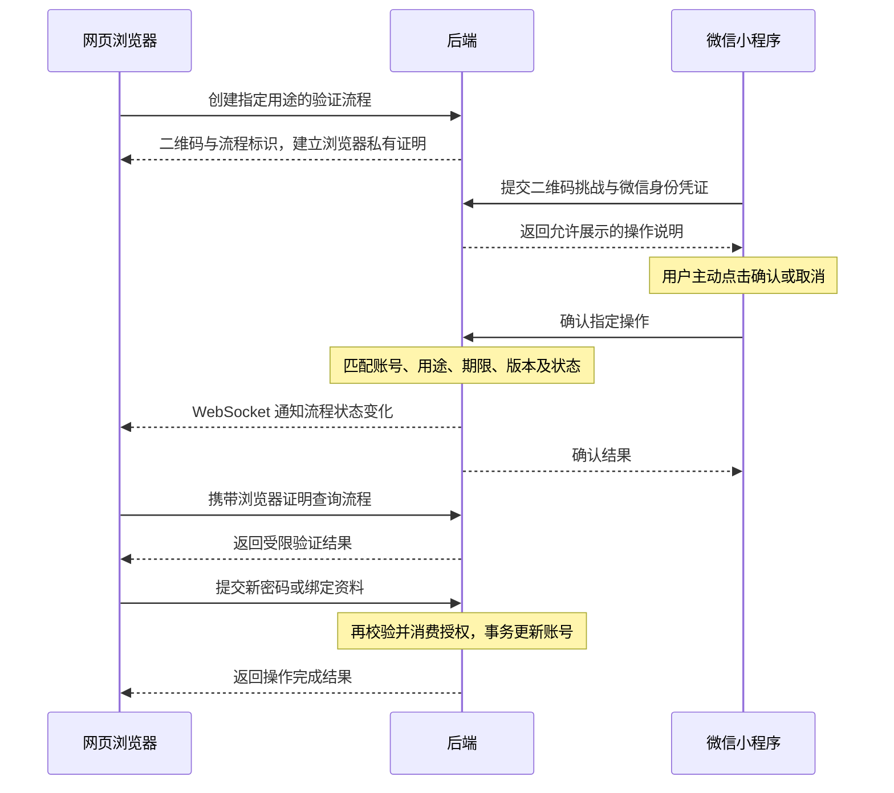

# 微信账号绑定与双通道找回设计

## 1. 目标、范围与当前状态

微信小程序扫码不可用时，已绑定凭证的用户仍能登录原 GOTO 账号；忘记密码时，可以通过绑定微信或已验证邮箱恢复访问。

本期包含 goto-web、goto-wechat、goto 后端，以及实际承载认证的 freedom-public 模块。复用原用户记录、密码认证、邮件发送、Redis 与 WebSocket 能力，不另建账号体系。原 userId、openid、namespace、文件、绘图记录、角色和权限保持归属不变。

本期闭环：登录后提醒 → 在原账号上一次绑定用户名、密码与验证邮箱 → 微信或密码登录 → 扫码或邮箱找回 → 个人中心维护密码和邮箱。

不包含账号合并、账号转让、手机号找回、公开注册改造、多因素登录体系、机密 R 包修改，以及小程序内再实现一套密码和邮箱表单。尚未绑定任何备用凭证且微信不可用的用户，不能凭知道 openid 自助设置密码；本方案不能追溯替这类用户建立身份凭证。

用户已于 2026-11-16 确认本文设计，并沿用本变更集实施。当前四端代码及累计返修已提交，最终代码复审Approved（C0/I0/M0），实际验证与未完成边界以关联实施计划为准；统一六类IT、完整账号浏览器、真实邮件收件、合法HTTPS真机及两条测试用户清理仍受阻。本文的设计约束不等于整体已验收或已上线，当前未合并、未部署。

## 2. 已确认的业务规则与方案取舍

用户已确认以下规则：

1. 对有 openid、未设置密码、未关闭提醒的用户，每次成功登录后提示设置备用登录方式。
2. “暂时跳过”仅影响本次登录；“不再提示”保存到账号，跨设备有效；已设置账号密码后不再弹该窗口。
3. 用户名、密码、邮箱及邮箱验证码一起完成，绑定才能成功；不允许密码已设置而邮箱未验证的首次绑定结果。
4. 用户名唯一。一个邮箱只绑定一个账号。
5. 密码为 10～30 位，包含大写字母、小写字母、数字、特殊符号，不允许空格，并拦截常见弱密码。
6. 找回密码优先显示微信扫码，同时允许立即切换邮箱，不要求先等微信失败。
7. 小程序需要同步修改：由用户确认具体操作，后端核验后通知网页；网页提交最终操作时后端再次校验。
8. 扫码可以证明账号身份，但不能代替验证新邮箱的归属。

比较过的方案：

| 方案 | 结果与原因 |
| --- | --- |
| 用户名、密码、邮箱验证一起完成 | 采用。设置结束即获得独立于微信的登录和找回能力 |
| 先设密码，邮箱稍后再绑 | 不采用。忘记密码且微信故障时仍会失去自助找回能力 |
| 找回只用微信，或每次要求微信和邮箱同时验证 | 不采用。前者不能应对微信故障，后者会让微信故障继续阻断找回 |

密码最低 10 位是用户选择的体验与安全取舍，不声称满足单因素密码最低 15 位的 NIST 建议；字符组合不替代弱密码拦截、限流和安全哈希。

## 3. 现有代码依据及复用边界

| 位置（相对 goto-software） | 已观察到的事实 | 对设计的约束 |
| --- | --- | --- |
| goto-web/src/views/login.vue | 当前主入口展示二维码 | 增加始终可用的密码登录切换和找回入口 |
| goto-web/src/api/login.js、src/store/modules/user.js | 已有账号密码认证和微信登录结果处理 | 复用认证结果结构，统一用户状态读取 |
| freedom-public/common-security/src/main/java/com/freedom/domain/User.java | 已有 username、password、email、openId | 为同一用户补齐凭证，不创建第二个用户 |
| freedom-public/eladmin-system/src/main/java/com/freedom/modules/system/rest/AuthorizationController.java | 查看过的扫码开户路径生成 GOTO 随机用户名；后端以微信 code 换取 openid | 用户名非空不能表示已绑定；身份来源继续由后端核实 |
| freedom-public/eladmin-system/src/main/java/com/freedom/modules/system/rest/UserController.java | 当前修改密码、邮箱流程要求当前密码 | 首次绑定和忘记密码使用独立的受限授权流程 |
| goto-wechat/pages/login/login.js、login.wxml | 扫码后自动认证，没有主动确认按钮 | 增加用途说明、确认与取消；扫码不自动授权敏感操作 |
| goto/system/src/main/java/com/freedom/service/QRCodeLoginService.java | 二维码标识使用雪花 ID，Redis 保存网页映射与状态 | 唯一标识不充当授权秘密；新安全挑战使用密码学安全随机数 |
| freedom-public/eladmin-system/src/main/java/com/freedom/modules/system/service/WebSocketService.java | 依据扫码标识查网页连接并推送登录结果 | 不直接把这段通知机制当作重置密码授权 |
| freedom-public/eladmin-system/src/main/java/com/freedom/modules/system/websocket/LoginWebWebSocket.java | 通用 security 校验关闭 | 登录前流程仍需单独证明连接归属，不能凭连接名称接收敏感结果 |

以上是当前本地代码的局部检查，不是完整审计，也未证明线上可被利用。实施前需同步各代码仓库并追踪真实调用链，特别是用户名与 openid 两类认证主体、缓存和 JWT 校验，避免仅更新一个入口。

## 4. 网页交互

### 4.1 登录与首次提醒

登录页提供“微信扫码”“账号密码”两个入口。微信二维码加载失败不得阻塞密码登录表单、图形验证码或邮箱找回。密码登录使用用户名，不在本期增加邮箱登录。

成功认证后读取后端给出的账号安全状态。提醒条件为：存在微信绑定、未启用密码登录、未关闭提醒。同一次登录的刷新、路由切换和令牌续期不重复弹；真正重新认证后重新判断。前端可保存当前登录会话的展示状态，账号永久偏好以后端为准。

弹窗文案：

> 设置备用登录方式
>
> 微信扫码暂时无法使用时，可以使用用户名和密码登录原账号，原有文件和绘图记录不受影响。请同时绑定邮箱，用于忘记密码时接收验证码。

按钮为“立即设置”“暂时跳过”“不再提示”。关闭弹窗等同“暂时跳过”，不隐式勾选“不再提示”。个人中心始终保留“账号与安全”入口。

已设置密码但缺少已验证邮箱的历史账号，不重复显示首次绑定弹窗，在个人中心提示完善找回邮箱；只有验证成功的邮箱可用于找回。

### 4.2 首次绑定

字段为用户名、密码、确认密码、邮箱、邮箱验证码。用户名使用仅去除首尾 ASCII 空格 U+0020 后的规范值；密码保持原始输入，不做 trim、自动改写或截断。前端实时显示校验结果，后端执行相同业务规则。

刚完成微信认证且后端可证明认证发生在最近 5 分钟内时，可复用这次身份认证；仅有旧登录 token、客户端时间或前端“已扫码”状态不满足要求。超时或缺少可靠认证记录时，从当前流程重新扫码确认。

邮箱验证码通过后形成绑定当前用户、规范化邮箱、用途和流程的一次性邮箱证明。修改邮箱字段会使该证明不再适用。全部检查通过后，在一个用户数据事务内保存用户名、密码哈希、邮箱验证状态与密码启用状态。

用户名发生变化后必须清理旧认证缓存。为避免旧用户名主体继续存在，首次绑定完成后提示“设置成功，请使用微信或新用户名密码重新登录”，撤销该账号旧会话。文件空间和业务对象仍按不变的用户标识关联，不按新用户名迁移文件。

### 4.3 找回、修改密码与邮箱

忘记密码先填写用户名，再选择验证方式。默认显示微信扫码，也可直接切换邮箱验证码。目标账号由服务端锁定；修改用户名必须重新开始验证，不能延用前一个账号的授权。

邮箱方式要求用户填写已绑定邮箱，后端核对账号与邮箱归属，不返回完整邮箱，也不通过不同提示暴露账号是否存在。发送接口统一提示“如果账号与绑定邮箱匹配，将发送验证码”。不得把用户临时输入的新邮箱当作找回通道。

验证成功后展示新密码和确认密码。成功重置后，旧密码失效、旧会话被撤销、此前未消费的恢复授权失效，用户重新登录。向已绑定邮箱发送安全通知；通知失败不回滚已经成功的密码变更，记录脱敏错误并提示实际结果。

已登录用户修改密码可验证旧密码后设置新密码；不知道旧密码时转入同样的微信或邮箱验证流程。所有设置新密码的入口使用同一校验规则。

换绑邮箱先验证账号本人，优先微信、也可使用原已验证邮箱；再验证新邮箱。当前账号没有已验证邮箱时，首次完善邮箱可使用近期微信认证，或重新输入正确的当前密码证明身份。旧邮箱失效但微信可用时，允许微信身份验证加新邮箱验证；两种身份通道均不可用时，不允许绕过验证。

换绑成功前保留旧邮箱；成功后新邮箱独占绑定，旧邮箱不能再找回该账号。向变更前后已知的邮箱发送安全通知；邮件内容不含密码或授权凭证。

## 5. 字段规则与唯一性

| 字段 | 本期规则 |
| --- | --- |
| 用户名 | 4～32 个 ASCII 字符，英文字母开头，其后只允许字母、数字、下划线；唯一性与登录匹配不区分大小写 |
| 密码 | 10～30 个 ASCII 可见字符，至少一个大写字母、小写字母、数字、非字母数字符号；不允许空格、控制字符、换行；两次输入完全一致 |
| 弱密码 | 后端使用本地维护的常见弱密码集合拒绝明显弱密码；拒绝与用户名或完整邮箱相同的密码；不向第三方发送明文密码 |
| 邮箱 | 普通常见 ASCII 邮箱地址（dot-atom 本地段与 DNS 域名，不支持引号本地段、IP 域字面量），整体最长 254 字符；前端正则初筛、后端成熟校验器复核，再以验证码证明可达与归属 |
| 邮箱规范值 | 仅去除首尾 ASCII 空格 U+0020，按业务规则整体忽略大小写；保留加号和点，不把不同地址擅自合并为别名 |
| 邮箱验证码 | 6 位十进制数字，使用安全随机源；只存储受保护的校验值，不在应用日志中打印 |

邮箱整体忽略大小写是本系统的明确业务约定，会将仅大小写不同的地址视为同一绑定名；不声称所有邮件服务器都采用这一规则。国际化邮箱支持不属于本期。

输入规则不得仅在前端执行；用户名、邮箱的可用性预检查不替代最终提交和数据库唯一约束。历史已存在的用户名和旧密码不因新设定规则而直接失去登录能力。

用户名唯一检查覆盖全部账号，包括自动生成名与旧账号。已验证邮箱的规范值必须有数据库唯一约束；历史未验证邮箱不作为找回凭证，也不能靠旧的任意填写值永久占用验证绑定。当前库表、索引和历史重复情况未查询，实施时需按项目数据库规范完成检查，冲突不得自动合并或覆盖账号。

## 6. 组件职责与数据状态

| 部分 | 责任 | 依赖 |
| --- | --- | --- |
| 网页登录及账号安全界面 | 收集输入、展示提醒和验证进度、提交最终操作 | 账号安全状态与受保护操作接口 |
| 后端账号凭证逻辑 | 字段校验、唯一性、事务保存、会话与缓存失效 | 现有用户仓储、密码编码器、认证和会话服务 |
| 后端短期验证逻辑 | 微信/邮箱身份核验、用途隔离、期限、限流和一次性授权 | 现有 Redis、微信认证与邮件能力 |
| 小程序确认页 | 获取服务端操作说明，用户主动确认或取消 | 微信身份凭证与短期挑战接口 |
| 状态通知 | WebSocket 状态推送，断线后可受保护查询 | 服务端流程状态、浏览器归属校验 |

不拆成新的独立服务。仅在现有模块内保留清晰职责；不建立无本期消费者的通用身份平台。

用户持久信息需要表达：密码登录是否启用、已验证邮箱规范值与验证时间、是否关闭绑定提醒，以及使旧会话与旧授权失效所需的账号安全版本。已有字段或会话机制能可靠表达的直接复用，不能仅因字段名不同再建一套状态。

历史迁移不得按用户名是否为 GOTO 前缀判断是否设置密码。结合现有密码哈希与认证可用状态形成迁移规则，保留既有可用密码登录；无法可靠识别的记录先列为迁移核查项，不设置默认密码。所有历史邮箱默认不新增“已验证”的推断。

短期挑战保存在 Redis，包含用途、目标 userId、创建时间、绝对过期时间、账号安全版本、浏览器归属证明、确认状态，以及涉及的目标邮箱。读取状态不会刷新有效期。身份确认、邮箱验证和最终操作不得跨用途交换凭证。

挑战状态最小集合为待确认、已确认、已取消、已过期、已消费。浏览器显示“已扫码”只作为进度，不产生授权。确认和消费均采用原子状态转换；终态不可恢复为待确认。

## 7. 微信小程序、后端和网页调用流程

小程序显示四种明确用途：登录 GOTO 网页、允许首次绑定备用凭证、允许重置密码、允许更换找回邮箱。敏感操作显示已匹配账号的脱敏信息及用户需要核对的目标邮箱；提醒仅确认本人刚刚在 GOTO 官网发起的操作。身份不匹配时返回通用失败，不向错误微信披露账号详情。

后台用微信 code 向微信核验身份，匹配当前小程序 AppID 下绑定的 openid；openid 是标识，不是密码。不能信任客户端传入的 userId/openid，也不能跨不同微信应用把同名 openid 当作相同身份。恢复流程遇到未匹配用户时不得自动开户。

二维码公开挑战与浏览器私有证明分别生成，采用至少 128 位安全随机强度，符合小程序 scene 容量限制。浏览器证明使用 Secure、HttpOnly、合理 SameSite 属性的受限 Cookie 或同等服务端校验机制；不得编码进二维码、URL、日志或公开状态响应。未登录用户也只能访问自己发起的恢复流程。域名、反向代理和 Cookie 作用域需在实施时核对实际部署，但不能以部署便利取消此约束。

WebSocket 仅传流程状态，不传密码、邮箱验证码或可独立用于重置的授权秘密。连接校验归属、浏览器 Origin 使用精确允许列表，断线后状态查询执行同样的归属校验。已登录连接还需检查会话有效性；撤销后不得继续接收受保护结果。采用 Cookie 的变更接口需要适用的 CSRF 防护。

普通扫码登录与敏感验证使用隔离用途。最终启用的新流程中，网页登录结果通过所属浏览器受保护的兑换步骤取得，不能直接把小程序的长期会话 token 当作网页找回授权。小程序已有会话按其自身流程处理，确认重置不自动创建网页登录。

## 8. 安全、原子性与错误处理

### 8.1 有效期与限流初值

以下为本期设计初值，在实施验收中按真实部署核对现有机制，不能仅用前端倒计时代替：

| 对象 | 约束 |
| --- | --- |
| 扫码挑战 | 创建后 5 分钟绝对过期；查询、扫码和确认不延长原期限 |
| 最终操作授权 | 单次使用；不超过所属流程的剩余期限；过期重新验证 |
| 邮箱验证码 | 5 分钟；同用途、账号及邮箱重新发送后，旧码失效 |
| 邮件发送 | 同邮箱、同用途至少间隔 60 秒；同邮箱总计最多 10 次/小时，同 IP 最多 30 次/小时 |
| 验证码猜测 | 每个挑战最多失败 5 次，随后作废；同时限制同账号及来源 IP 的累积尝试 |
| 密码登录 | 同规范化用户名 15 分钟最多失败 10 次、同 IP 15 分钟最多失败 50 次；超过后暂时节流，不永久锁死账号 |
| 扫码与状态接口 | 限制创建、确认与查询频率；网页查询间隔不短于 2 秒，结束或过期停止查询 |

邮件发送和找回响应对不存在账号维持一致语义与相近处理路径，避免账号枚举。限流记录中的账号、邮箱使用必要的脱敏键，不记录密码、验证码、微信 code 或完整 token。

### 8.2 一次性授权与数据事务

最终提交先进行格式和业务预检查，再原子地把本次授权从可用改为已消费；随后在用户事务中再次检查账号安全版本、归属与唯一约束，更新凭证并推进安全版本。同一授权的并发提交只有一个可以进入更新路径。

Redis 和数据库不是一个天然事务。本期采用安全优先的明确失败语义：授权消费后数据库保存失败，用户数据整体回滚，但授权不恢复为可用，用户重新验证再提交；不能为自动重试而放开重复使用。数据库提交成功但响应丢失时，以受保护状态查询或重新登录确认结果，不重复执行凭证更新。

首次绑定、改密、重置和换邮箱均推进账号安全版本，旧版本会话及未消费授权不能继续使用。数据库版本校验与凭证更新必须在同一事务中完成。会话删除或通知失败时，也要保证旧 token 在服务端请求校验时被拒绝，不能只靠前端清理缓存；复用现有在线会话校验能力，不满足时补齐最小版本校验。

所有业务凭证变更接口统一执行上述规则，包括历史个人中心及管理入口，不能留下可以直接写密码、邮箱验证状态或安全版本的绕过路径。管理功能仍遵守原有权限，不因此新增普通用户权限。

### 8.3 必须拒绝的情况

错误微信、错误邮箱、挑战未知、取消、过期、已消费、操作用途不符、目标账号或目标邮箱改变、浏览器证明不符、账号安全版本过期、账号已禁用，均拒绝最终操作。必要依赖不可用时拒绝授权，不自动降级为跳过验证；用户可主动切换另一种验证方式并创建新的流程。

邮件发送失败保留表单内容，但不标记邮箱已验证。邮箱和用户名并发冲突由数据库约束兜底，返回可操作提示，不能合并用户。密码仅用安全单向哈希保存，复核现有编码器参数，不保存可恢复的密码或在日志中输出。

### 8.4 残余风险

扫码或邮箱二选一提供可用性冗余，不构成双因素验证。绑定微信或邮箱被接管，都可能导致账号恢复权限被滥用。二维码转发钓鱼不能仅靠浏览器绑定消除，需要清晰的操作与账号确认文案；不承诺彻底防钓鱼。浏览器 XSS 和设备失陷仍属于相关风险，不能以 HTTPS/WSS 已开启就声称消除。

## 9. 上线与历史兼容

1. 同步 goto-web、goto-wechat、goto、freedom-public 的真实基线，核对相关源码、依赖版本、数据库字段、邮件可用性及旧认证入口。全过程排除四个机密 R 包及其副本。
2. 检查历史用户名规范化冲突、邮箱重复和验证依据；阻断唯一约束的冲突先列出处理范围，禁止自动合并、删除或覆盖用户。新增字段兼容旧客户端，旧可用密码保持可登录。
3. 先部署兼容后端：敏感操作与普通登录用途隔离，旧登录入口不能确认新的敏感挑战；身份校验和一次性消费由后端强制执行，不能依靠客户端自报版本。
4. 发布并验证小程序确认页；旧版本对未知敏感用途明确拒绝并提示更新，不把自动登录结果当作重置成功。
5. 再开放网页完整流程。现有二维码采用正式小程序版本，联调与发布必须分别验证体验版/正式版对应关系，不以本地页面正常推断正式微信扫码可用。
6. 微信确认暂时不可用时，已经上线的密码登录和邮箱找回继续可用。回滚不删除已绑定数据、不恢复旧密码、不重新启用失效授权。

发布顺序不构成当前部署授权。本阶段仅交付设计，实际部署按后续明确任务和项目规则执行。

## 10. 验收条件

| 编号 | 场景 | 必须得到的结果 |
| --- | --- | --- |
| A01 | 扫码老用户首次绑定并用新密码登录 | 进入同一 userId，文件、绘图记录、权限与 namespace 保持归属 |
| A02 | 微信接口或二维码服务不可用 | 密码登录、邮箱找回可独立完成 |
| A03 | 暂时跳过、刷新、路由切换、重新登录 | 本次会话不重复提示，下次真实登录重新判断 |
| A04 | 不再提示后换设备；已绑定用户登录 | 均不弹首次绑定提示，个人中心仍可维护 |
| A05 | 长度、字符类别、弱密码、邮箱格式、确认密码不符 | 前端提示，绕过前端直接请求仍被后端拒绝 |
| A06 | 用户名大小写冲突、同邮箱并发绑定不同用户 | 最多一个有效绑定，无账号合并和半完成状态 |
| A07 | 邮箱验证码错、过期、重发、重复使用、超次数 | 旧码或无效码不能授权；限流由后端执行 |
| A08 | 非目标微信扫码、伪造 userId/openid | 不授权、不开户、不泄露目标账号详情 |
| A09 | 将登录确认用于改密，改变目标账号或邮箱 | 用途和目标绑定检查拒绝 |
| A10 | 二维码取消、过期、重复确认、并发最终提交 | 终态不可重启，最终更新最多成功一次 |
| A11 | 其他浏览器订阅或查询、伪造推送、直接调最终接口 | 不能取得授权或修改账号；通知不是权限依据 |
| A12 | 重置后使用旧密码、旧网页/小程序 token、其他旧授权 | 全部失效；新登录有效 |
| A13 | Redis/数据库/邮件异常，提交响应丢失 | 遵守失败语义，不产生部分绑定或重新放行已消费授权 |
| A14 | 原邮箱不可用但微信可用，更换邮箱 | 微信确认加新邮箱验证可完成；旧邮箱随后不能找回 |
| A15 | WebSocket 断线、网页恢复、小程序取消 | 状态可受保护查询恢复，取消不会显示成功 |
| A16 | 旧小程序访问新敏感二维码、兼容期调用旧接口 | 拒绝敏感授权；不能绕过新流程 |
| A17 | 新旧用户名主体、openid 主体、缓存和文件路径 | 无旧名缓存越权，无文件丢失或跨账号访问 |
| A18 | 日志、接口响应、用户信息 DTO | 不含密码哈希、验证码、微信 code 或授权秘密 |

验证层次包括后端规则与并发测试、网页交互测试、小程序开发者工具和真机扫码联调。当前阶段没有执行这些功能验收。

实现后的 Java 编译测试、启动关闭、home profile、动态端口、本次工作区 Playwright 和临时登录页恢复，按项目本地验收规范执行。网页自动化不能替代小程序真机确认与发布版本验证；未执行时必须明确记录为未完成。

## 11. 设计自查、实施前核查与文档归属

自查范围：业务规则一致性、账号和邮箱身份验证的区分、前后端校验一致、一次性授权与数据库事务的失败语义、老用户迁移、发布兼容及可验证性。实施前仍需核查数据库真实状态、邮件发送链路、实际密码编码器、会话撤销机制与各仓库同步后的调用链；这些是必须完成的实施前置检查，不代表放宽本文约束。

文档中心原件：`goto-docs/superpowers/_global/specs/2026-11-16-微信账号绑定与双通道找回设计.md`。跨子项目设计只保留这一份逻辑规格，不在每个子仓库重复生成规格。

Git 记录：文档仓库 goto-docs，远端 origin，基线 origin/main；于 2026-11-16（Asia/Shanghai）通过 Windows git.exe 成功 fetch，确认远端 SHA 为 `f324522619eee8162f7432010b8e6d4c67f7d478`。隔离提交分支 `docs/033-账号绑定与双通道找回` 的实际起点为同一 SHA，并已核验祖先关系。中心工作区处于其他任务分支且有无关未跟踪文件，因此不移动该分支；原件仅新增本设计文件，使用隔离工作区中的逐字一致副本提交。本任务不合并、不推送。

平台 worktree 创建接口无法解析该独立文档仓库提交，返回 `Needed a single revision`；随后使用指定文档仓库的 git worktree 创建隔离提交工作区。未重试相同失败操作，未改变其他仓库。当前只是设计审阅节点，后续设计、计划、实现沿用文首变更集 ID，不提前创建终态完成总结。

参考：[OWASP 操作授权](https://cheatsheetseries.owasp.org/cheatsheets/Transaction_Authorization_Cheat_Sheet.html)、[WebSocket 安全](https://cheatsheetseries.owasp.org/cheatsheets/WebSocket_Security_Cheat_Sheet.html)、[密码找回](https://cheatsheetseries.owasp.org/cheatsheets/Forgot_Password_Cheat_Sheet.html)、[NIST 密码要求](https://pages.nist.gov/800-63-4/sp800-63b.html)。参考资料用于支撑安全控制，不代表当前实现已符合其全部要求。

实施联调修正：账号专用WebSocket最终使用`/webSocket/account-flow/connect`。真实应用中旧JSR-356动态端点`/webSocket/{sid}`会优先接管原两段路径，隔离新处理器的测试未覆盖共存；改为三段路径并同步网页、代理与真实共存握手回归。用途、首帧一次性票据、Origin及后端授权规则不变，旧端点保持原业务。
